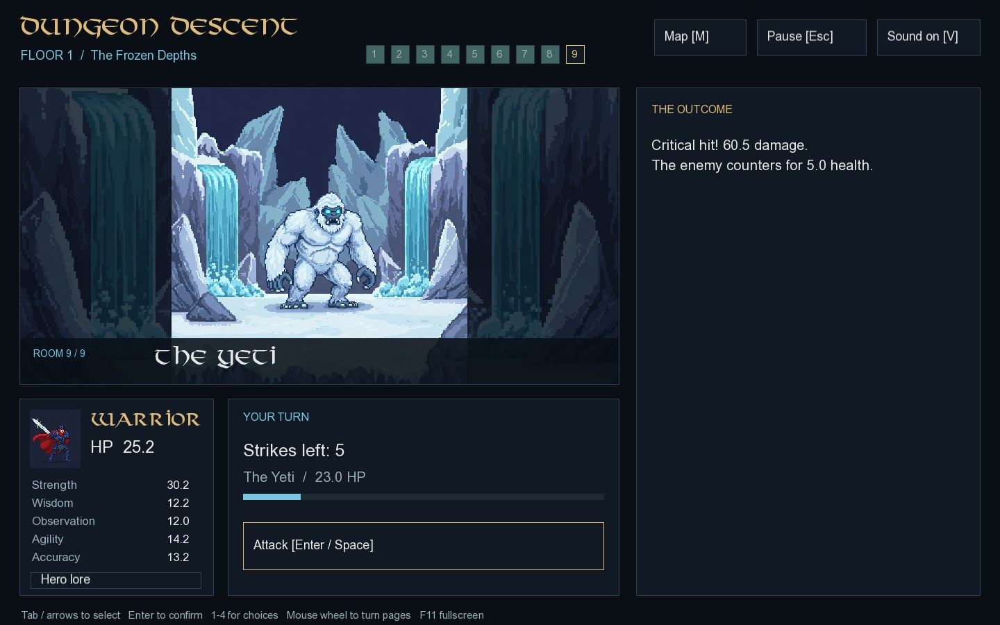
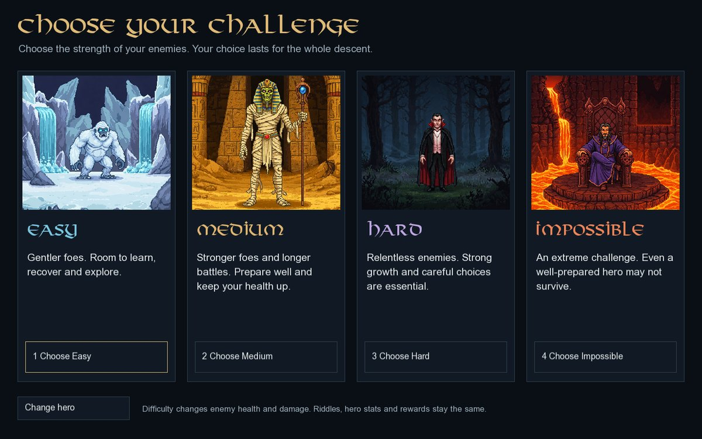
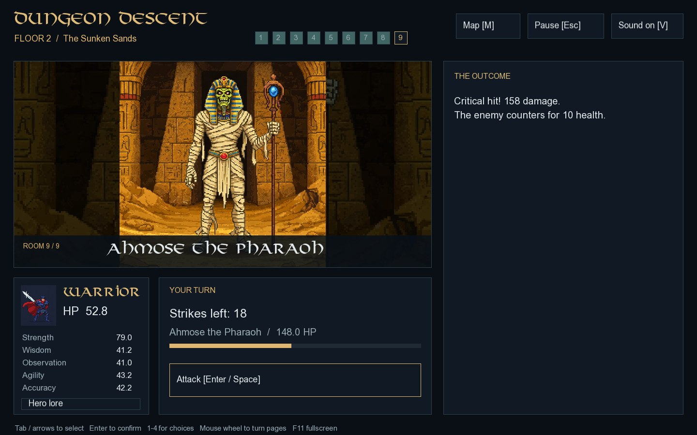
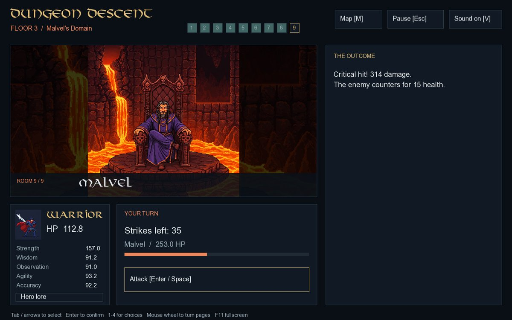

# Dungeon Descent

A story-driven fantasy adventure about riddles, choices and the truth beneath Aethoria. Choose a hero and enter a magical dungeon to rescue a princess believed to have been captured by the sorcerer Malvel.

Play through **all three connected floors**, from the animated menu and hero selection to Malvel's domain and four branching endings. The same hero, health, stats, reputation and choices carry through the entire descent.

The game starts in **fullscreen**. Press **F11** to switch between fullscreen and a resizable window.

## Features

- Warrior, Ranger, Mage and Rogue, with their original starting stats, automatic class abilities and reward multipliers.
- Five biomes: **Ice / Jungle** on floor 1, **Desert / Ghost** on floor 2 and **Lava** on floor 3.
- Twenty-seven rooms, with shuffled openings, battles, libraries, shops, respite, encounters, guardians and Malvel.
- Eight timed riddles per floor, drawn without replacement from the original 30 easy, 37 medium and 35 hard riddles. No new riddles were added. Answer choices are shuffled; high Observation eliminates one incorrect option.
- Sealed chest rewards, the second-floor vision, the princess's diary, the lava orb, healing, reputation and branching encounter dialogue.
- Turn-based combat, critical hits, limited strikes, enemy health and visible battle feedback.
- **Easy, Medium, Hard and Impossible** combat difficulties. Choose after your hero; the level is fixed for the descent. Easy preserves the previous enemy stats. Higher levels change enemy health and counterattack damage, with separate profiles for opening fights, later fights and guardians.
- The original narrated lore intro over the candle animation, followed by the animated main menu. The voice-over plays once above the background music; any key or click skips to the menu.
- A map and room progress, hero lore, paginated story text, biome music and sound toggle.
- The original good, true and bad endings, plus **A Crown in Ashes**, a fourth ending for a perfect run: win all **9 battles**, solve all **24 riddles** and earn **9 reputation**. Each ending has a full story, artwork and journey results.
- Mouse and keyboard controls, fullscreen startup, resizable windows and pause between riddles.

Defeat the Yeti or Jungle Warden to unlock the second-floor door choice. Defeat Ahmose the Pharaoh or Count Dracula to enter Malvel's domain. Floor transitions continue the current descent; starting again is available only after an ending or game over. See the [floor-one](docs/FLOOR_ONE.md), [floor-two](docs/FLOOR_TWO.md) and [floor-three](docs/FLOOR_THREE.md) guides for routes and rewards.

Difficulty leaves hero stats, rewards, riddles, timers and ending conditions unchanged. Enemy health and counterattack damage are shown before a fight. See the [combat balance guide](docs/COMBAT_BALANCE.md) for the stat tables, simulation results and reproduction commands.

## Build and run on Windows

1. Install Visual Studio 2022 with **Desktop development with C++**, the MSVC v143 toolset and a Windows SDK.
2. Open `Dungeon_Descent.sln`.
3. Select **Standalone | x64** and build to make a single executable. The first build requires Git, CMake 3.24+ (or Visual Studio's **C++ CMake tools for Windows**) and an internet connection to compile the pinned dependencies.
4. Run with **Ctrl+F5**, or share just **`dist/Dungeon_Descent.exe`**.

Standalone includes SFML, the Visual C++ runtime, images, fonts, music and story files. No additional DLLs or asset folders need to accompany the EXE. On first launch it prepares a private asset cache under `%LOCALAPPDATA%\DungeonDescent\assets`; later launches verify and reuse it. See [standalone builds](docs/STANDALONE.md) for details and the PowerShell build command.

For faster development builds, **Debug | x64** and **Release | x64** still use the bundled SDK and copy assets and DLLs beside the game in `build/x64/<configuration>/`. Keep that entire output together when running those builds.

The active game is native C++17/SFML 3.0.0. It no longer requires C++/CLI, Windows Forms or the .NET Framework Developer Pack. The bundled SFML SDK is for MSVC x64.

For CMake, Linux, tests, asset paths and troubleshooting, see [development setup](docs/SETUP.md).

## Controls

| Input | Action |
| --- | --- |
| Left click | Select a button. |
| `1`–`4` | Select a displayed numbered choice. |
| `Tab`, `Shift+Tab`, Up/Down | Move between controls. |
| `Enter` / `Space` | Activate the selected control; attack when selected. |
| Left/Right, Page Up/Down, mouse wheel | Turn story pages. |
| `M` | Open/close the floor map between timed riddles. |
| `Esc` | Pause/resume between timed riddles, close an overlay, or go back. |
| `V` | Mute/unmute music and intro narration. |
| `F11` | Toggle fullscreen. |

Timed riddles cannot be paused. Pause, map and hero-lore controls are disabled while the countdown runs; switching windows or opening the quit confirmation does not stop it. There are no room/floor retries or restart controls during a descent. After game over or an ending, view your results and return to the main menu to begin again. Runs are held in memory; closing the game ends the current run.

## Repository layout

| Path | Contents |
| --- | --- |
| `Dungeon_Descent.sln` | Native SFML Visual Studio solution. |
| `CMakeLists.txt` | Portable game and test build. |
| `src/DungeonDescent/StartScreen.cpp` | Entry point, asset discovery and startup errors. |
| `src/DungeonDescent/sfml/` | SFML interface and independent three-floor run rules. |
| Other files in `src/DungeonDescent/` | Preserved original Windows Forms game and classes, used as references. They are not compiled by the active project. |
| `assets/` | Original artwork, fonts, animation frames, music and story/riddle text. |
| `tests/` | Rules tests and optional SFML render/input tests. |
| `tools/CombatBalance.cpp` | Reproducible simulation of the real combat/run rules. |
| `tools/Build-Standalone.ps1` | Windows single-executable build and dependency checks. |
| `src/DungeonDescent/portable/` | Embedded assets, extraction and cache validation. |
| `third_party/SFML-3.0.0/` | Bundled Windows SDK and original notices. |
| `docs/` | Setup, routes and rules for each floor, and screenshots. |
| `build/` | Ignored generated output. |
| `dist/` | Ignored standalone executable, ready to share. |

## Authors

Developed as a **COMP315 Group 7** project.

- Lokadi Naicker
- Arjun Ramphal
- Darian Robert
- Ashutosh Maraj
- Zaid Kajee
- Sikhulile Dlamini
- Keolin Naicker
- Zaheera Ganie
- Nafees Abdulla

SFML and its bundled files retain their original notices. See [third-party information](third_party/README.md).
