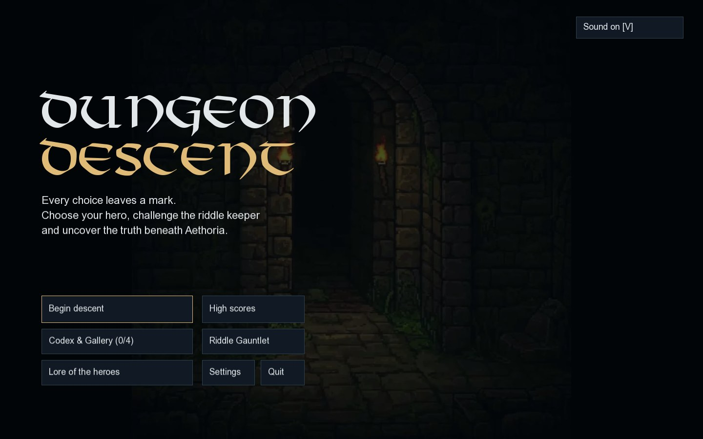
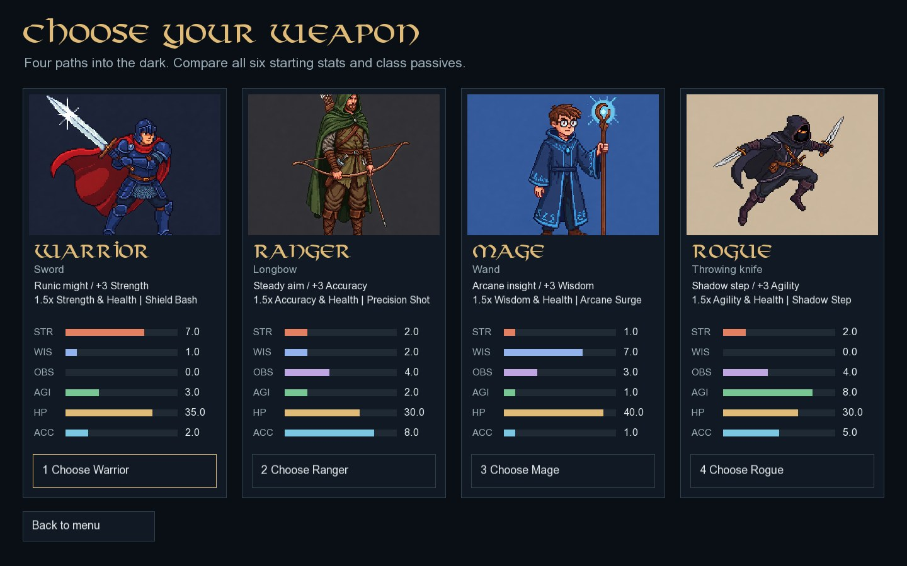
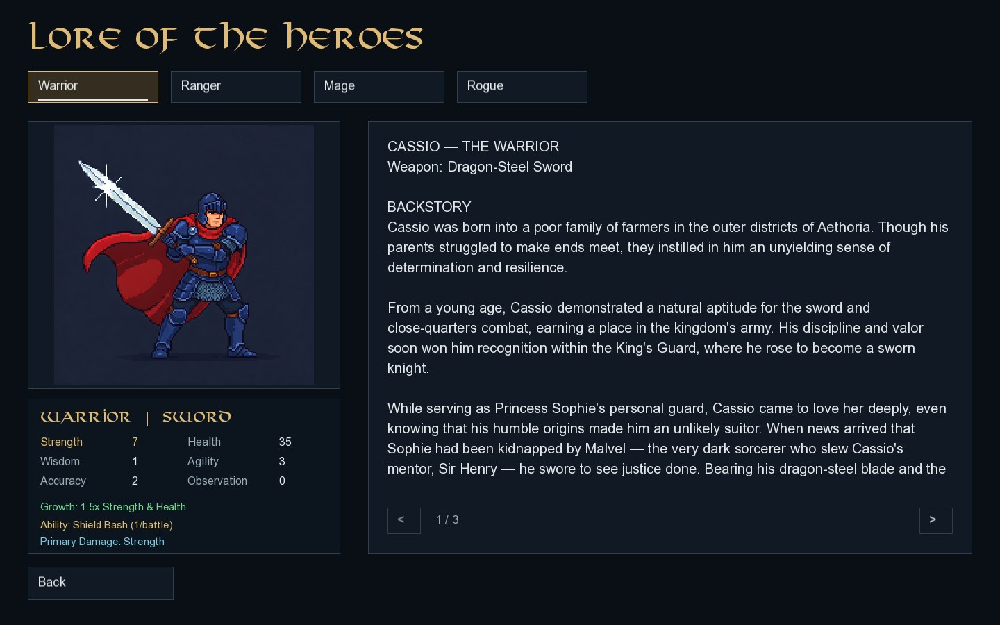
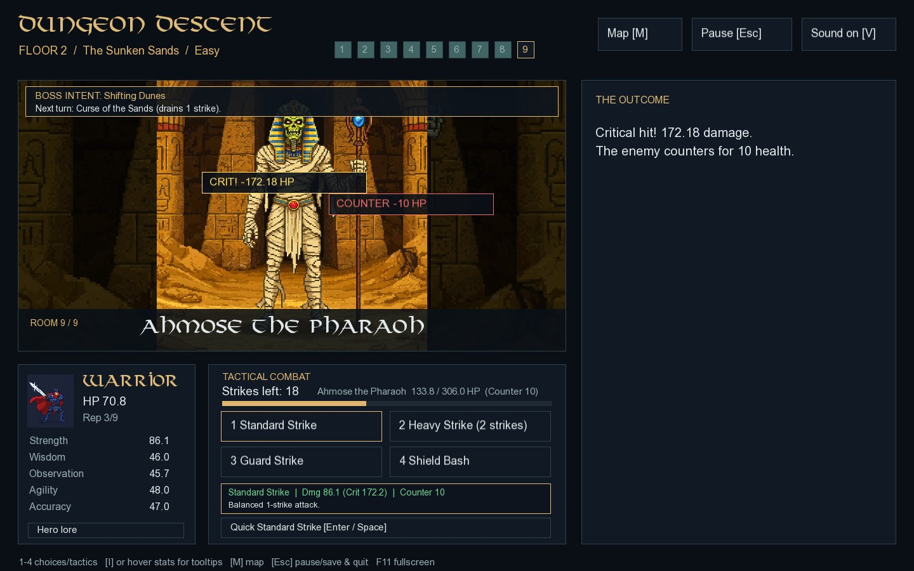
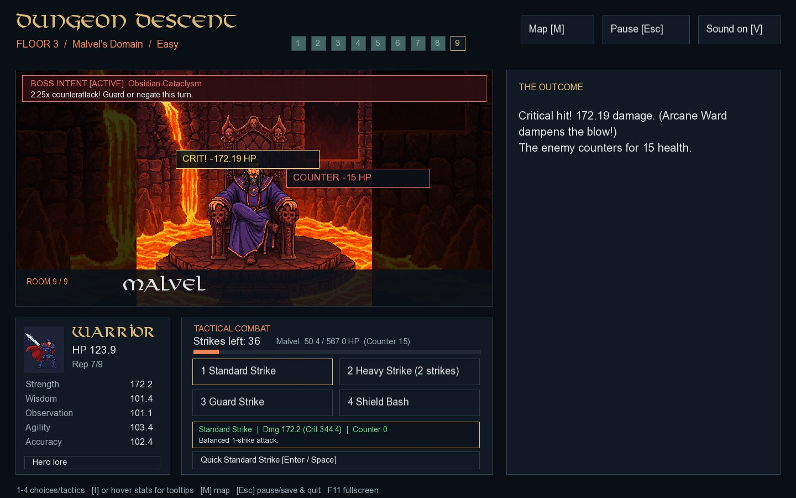
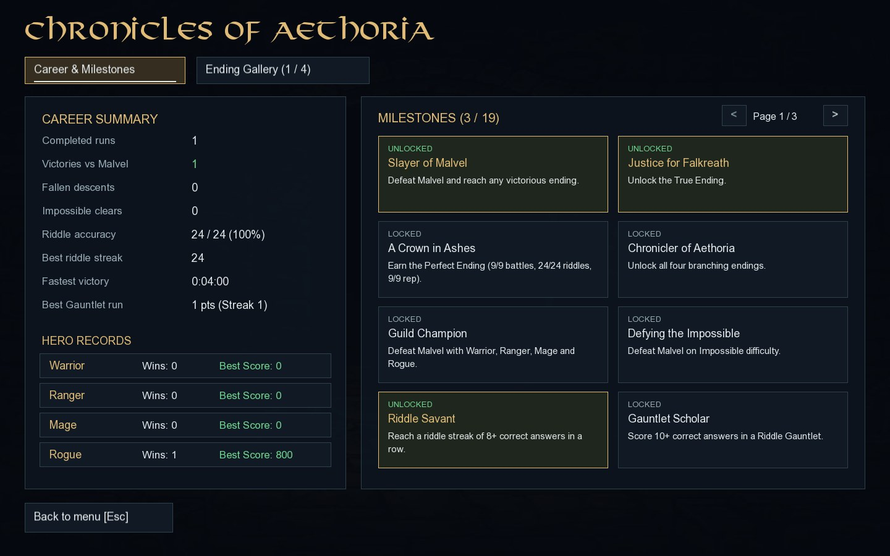
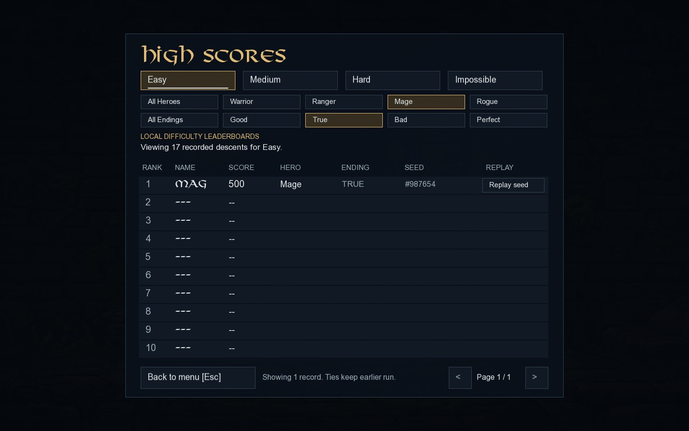

# Dungeon Descent

A story-driven fantasy adventure about riddles, tactical combat, choices and the truth beneath Aethoria. Choose a hero and enter a magical dungeon to rescue a princess believed to have been captured by the sorcerer Malvel.

Play through **all three connected floors**, from the narrated candle intro and animated main menu to Malvel's domain and four branching endings. The same hero, health, stats, reputation and choices carry through the entire descent.

The game starts in **fullscreen** (configurable in Settings and persisted between launches). Press **F11** at any time to switch between fullscreen and a resizable window.

## Features

- **Four Distinct Heroes**: Warrior (Cassio), Ranger (Halt), Mage (Elian), and Rogue (Asher), each with a 6-stat hero selection breakdown, updated hero lore with stat cards, balanced **1.5x primary-stat and Health** reward multipliers, and a unique once-per-battle tactical ability (**Shield Bash**, **Precision Shot**, **Arcane Surge**, **Shadow Step**).
- **Five Biomes Across Three Floors**: **Ice / Jungle** on Floor 1, **Desert / Ghost** on Floor 2, and **Lava** on Floor 3 — twenty-seven rooms in total with shuffled openings, battles, libraries, shops, respite, encounters, guardians and Malvel. Choice buttons show narrative choices without spoiling exact stat rewards.
- **Tactical Combat & Unique Telegraphed Boss Intents**: Choose between Standard Strike, Heavy Strike (2 strikes), Guard Strike (25% counterattack), and your hero's Class Ability. Live hovered/focused action previews show exact normal damage, crit damage, and expected counterattack. Every one of the five bosses has a unique telegraphed mechanic:
  - *The Yeti (Ice)* — **Glacial Slam** (`2x` counterattack)
  - *The Jungle Warden (Jungle)* — **Thorned Carapace** (`1.6x` counterattack on unguarded strikes; Guard/Ability bypasses thorns)
  - *Ahmose the Pharaoh (Desert)* — **Curse of the Sands** (`1.75x` counterattack + drains 1 strike unless Guarded/negated)
  - *Count Dracula (Ghost)* — **Blood Siphon** (`1.5x` counterattack + heals `2x` damage dealt)
  - *Malvel (Lava)* — **Arcane Ward** (`50%` damage reduction vs Standard/Guard; Heavy/Ability pierces) and **Obsidian Cataclysm** (`2.25x` counterattack)
- **Riddles, Streaks & Standalone Riddle Gauntlet**: Eight timed riddles per floor drawn without replacement from the original 30 easy, 37 medium, and 35 hard riddles. Consecutive correct answers build a **Riddle Streak Bonus** (+15% stat rewards at 3–4, +30% at 5+). High Observation (`> 30`) eliminates one false answer, and Wisdom extends timers by `floor(Wisdom / 2)` seconds. Challenge all 102 riddles (Easy → Medium → Hard) with 3 lives in the standalone **Riddle Gauntlet** mode from the main menu.
- **Easy, Medium, Hard and Impossible Difficulties**: Choose after selecting your hero; enemy health and counterattack profiles scale per tier while hero stats, rewards, riddles, and ending thresholds remain unchanged.
- **Custom Seeds & Daily Runs**: Play with a random seed, type any numeric or alphanumeric custom seed on the biome selection screen, or challenge the deterministic Daily Run seed.
- **Pause, Suspend Run & Discard-to-Menu**: Between timed riddles, open the Pause menu (`Esc`) to adjust Audio & Display Settings, **Save & quit to menu (Suspend run)** to a single-slot atomic save file and resume later, or **Return to main menu (Discard run)** without saving or closing the game.
- **Chronicles of Aethoria (Codex, 15 Milestones & Ending Gallery)**: Persistent career statistics, per-hero records, Riddle Gauntlet high scores, an **Ending Gallery (`0/4`–`4/4`)** to revisit unlocked ending artwork and stories, and **15 unlockable milestones** across two pages (including *Fallen to the Sorcerer*, *Claimed by the Depths*, *Ruthless Descent* for choosing kill in all 3 NPC encounters in one run, and *Pure Steel* for clearing Easy, Medium, Hard, and Impossible without using a class ability once).
- **Local Leaderboards with Hero & Ending Filters + Seed Replay**: Separate local boards for Easy, Medium, Hard, and Impossible displayed 10 records per page with `<` / `>` pagination. Combine **Hero** and **Ending** filters while preserving true difficulty rank, inspect saved run seeds, and click **Replay seed** to launch that exact seed, hero, and difficulty.
- **Settings, Audio & Presentation**: Persistent **Settings** overlay (Music, SFX, and Narration volume sliders, audio mute, and fullscreen/windowed toggle), smooth music crossfading, subtle screen/chamber transitions, procedural combat/UI sound effects, custom window and Windows EXE/taskbar icons, and optimized OGG/JPG media assets.
- **Four Branching Endings**: The original Good, True, and Bad endings, plus **A Crown in Ashes**, a fourth ending for a 100% run (win all **9 battles**, solve all **24 riddles**, and earn **9 reputation**).

Defeat the Yeti or Jungle Warden to unlock the second-floor door choice. Defeat Ahmose the Pharaoh or Count Dracula to enter Malvel's domain. See the [floor-one](docs/FLOOR_ONE.md), [floor-two](docs/FLOOR_TWO.md) and [floor-three](docs/FLOOR_THREE.md) guides for routes and rewards, and the [combat balance guide](docs/COMBAT_BALANCE.md) for stat tables and simulation results.

## Screenshots

| Hero Selection & Stat Breakdown | Hero Lore & Class Card |
| --- | --- |
|  |  |

| Floor 1 Guardian & Active Boss Intent | Floor 2 Guardian (Ahmose the Pharaoh) |
| --- | --- |
|  |  |

| Final Confrontation with Malvel | Difficulty Selection |
| --- | --- |
|  |  |

| Chronicles of Aethoria (Codex & Milestones) | Leaderboards (Hero & Ending Filters + Seed Replay) |
| --- | --- |
|  |  |

## Build and run on Windows

1. Install Visual Studio 2022 with **Desktop development with C++**, the MSVC v143 toolset and a Windows SDK.
2. Open `Dungeon_Descent.sln`.
3. Select **Standalone | x64** and build to make a single executable. The first build requires Git, CMake 3.24+ (or Visual Studio's **C++ CMake tools for Windows**) and an internet connection to compile the pinned dependencies.
4. Run with **Ctrl+F5**, or share just **`dist/Dungeon_Descent.exe`**.

Standalone includes SFML, the Visual C++ runtime, images, fonts, OGG music/narration, window/EXE icon, and story files. No additional DLLs or asset folders need to accompany the EXE. On first launch it prepares a private asset cache under `%LOCALAPPDATA%\DungeonDescent\assets`; later launches verify and reuse it. See [standalone builds](docs/STANDALONE.md) for details and the PowerShell build command.

For faster development builds, **Debug | x64** and **Release | x64** use the bundled SDK and copy assets and DLLs beside the game in `build/x64/<configuration>/`. Keep that entire output together when running those builds.

The active game is native C++17/SFML 3.0.0. For CMake, Linux, tests, asset paths and troubleshooting, see [development setup](docs/SETUP.md).

## Controls

| Input | Action |
| --- | --- |
| Left click | Select a button, filter pill, or stat tooltip target. |
| `1`–`4` | Select a displayed numbered choice or tactical combat action. |
| `Tab`, `Shift+Tab`, Up/Down | Move between controls. |
| `Enter` / `Space` | Activate the selected control; quick Standard Strike in combat. |
| Left/Right, Page Up/Down, mouse wheel | Turn story pages or leaderboard pages. |
| `I` | Cycle through hero stat tooltips on the HUD. |
| `M` | Open/close the floor map between timed riddles. |
| `Esc` | Pause/resume between timed riddles, close an overlay, or go back. |
| `V` | Mute/unmute music, sound effects and intro narration. |
| `F11` | Toggle fullscreen (saved automatically). |

Timed riddles cannot be paused. Pause, save & quit, discard-to-menu, settings, map and hero-lore controls are disabled while the countdown runs; switching windows or opening the quit confirmation does not stop it.

After reading an ending, **View your journey** (or `Esc`) opens the matching difficulty leaderboard alongside your final results. Type **three letters**, use **Backspace** to edit and **Enter** to save, or skip entry with `Esc`. See [leaderboards](docs/LEADERBOARDS.md) for storage, filtering, seed replay and ranking details.

## Repository layout

| Path | Contents |
| --- | --- |
| `Dungeon_Descent.sln` | Native SFML Visual Studio solution. |
| `CMakeLists.txt` | Portable game and test build. |
| `.github/workflows/ci.yml` | GitHub Actions CI validating Linux SFML builds/tests and Windows MSVC solution + rules tests. |
| `src/DungeonDescent/StartScreen.cpp` | Entry point, asset discovery and startup errors. |
| `src/DungeonDescent/AppIcon.rc` | Windows executable & taskbar icon resource script. |
| `src/DungeonDescent/sfml/` | SFML interface, three-floor run rules (`DungeonRun`), procedural SFX (`SoundEffects`) and local leaderboards (`Leaderboards`). |
| `src/DungeonDescent/portable/` | Embedded assets (`AssetBundle`), OS file locking (`FileLock`), suspend-save (`SuspendSave`), settings (`Settings`), and Codex/Gallery persistence (`Codex`). |
| `assets/` | Optimized artwork, fonts, animation frames, OGG music/narration, window icon, and story/riddle text. |
| `tests/` | Rules, balance, suspend-save, codex/settings, asset-bundle, leaderboard and SFML render/input tests. |
| `tools/CombatBalance.cpp` | Reproducible simulation of the real combat/run rules. |
| `tools/Build-Standalone.ps1` | Windows single-executable build and dependency checks. |
| `third_party/SFML-3.0.0/` | Bundled Windows SDK and original notices. |
| `docs/` | Setup, routes and rules for each floor, leaderboards, and updated screenshots. |
| `build/` | Ignored generated output. |
| `dist/` | Ignored standalone executable, ready to share. |

## Authors

Developed as a **COMP315 Group 7** project.

- Lokadi Naicker
- Arjun Ramphal
- Darian Robert
- Ashutosh Maraj
- Zaid Kajee
- Sikhulile Dlamini
- Keolin Naicker
- Zaheera Ganie
- Nafees Abdulla

SFML and its bundled files retain their original notices. See [third-party information](third_party/README.md).
