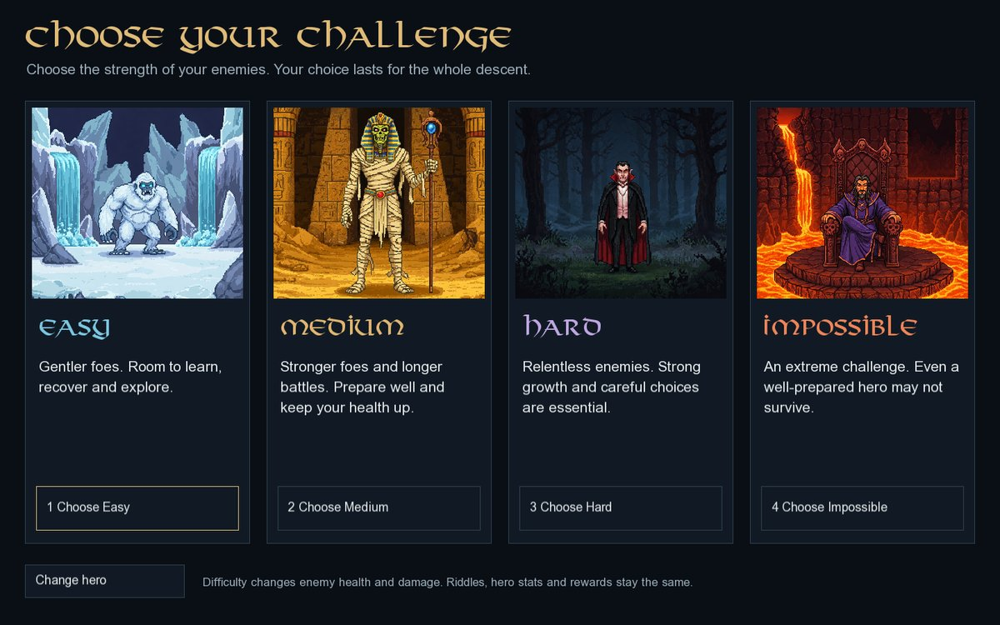

# Combat difficulty and balance

Choose **Easy**, **Medium**, **Hard** or **Impossible** after selecting a hero and before opening the first door. Easy is the default and uses the previous version's exact enemy health and damage. The selected level is fixed until the descent ends and appears in the game HUD and journey results. Before starting, Escape or **Change difficulty** returns to the selection screen without losing the chosen hero.



Difficulty changes only enemy maximum Health and counterattack damage. Starting hero stats, class bonuses, stat rewards, critical-hit rules, strike counts, room choices, reputation, riddles, countdowns, loot and ending requirements are the same on every level. Enemies use fixed profiles; they do not secretly scale with the hero's class, current Health or damage. All four endings remain governed by their existing conditions.

## Enemy stats

Each cell is **Health / damage per counterattack**. The opening encounter is the shuffled battle among rooms 1–3. The later encounter is room 5 on floors 1 and 3, and room 8 on floor 2. Guardians include Malvel. Biome variants use the same combat profile.

| Floor | Encounter | Easy | Medium | Hard | Impossible |
| --- | --- | --- | --- | --- | --- |
| 1 | Opening | 32 / 3 | 36 / 3 | 48 / 3 | 56 / 3 |
| 1 | Later | 32 / 4 | 48 / 4.25 | 60 / 4.5 | 70 / 4.75 |
| 1 | Guardian | 144 / 5 | 190 / 5.25 | 230 / 5.25 | 450 / 5.5 |
| 2 | Opening | 68 / 6 | 100 / 6.25 | 125 / 6.5 | 145 / 6.75 |
| 2 | Later | 68 / 8 | 145 / 8.25 | 175 / 8.5 | 210 / 8.75 |
| 2 | Guardian | 306 / 10 | 480 / 10.5 | 550 / 10.5 | 620 / 10.75 |
| 3 | Opening | 126 / 9 | 220 / 9.25 | 280 / 9.5 | 330 / 9.75 |
| 3 | Later | 126 / 12 | 300 / 12.25 | 350 / 12.5 | 420 / 12.75 |
| 3 | Malvel | 567 / 15 | 1000 / 15.5 | 1200 / 15.75 | 1450 / 16 |

The profiles live in `EnemyBalance` in `src/DungeonDescent/sfml/DungeonRun.cpp`. Raising a mode always increases enemy Health and never reduces its counterattack damage. Combat previews and active fights show these values, including fractional damage. Killing blows still prevent retaliation. A failed ordinary fight still retreats with the existing penalty; a failed guardian never counts as a clear.

## Why the profiles differ by encounter

A flat multiplier made early shuffled fights disproportionately punishing while late enemies still fell quickly to accumulated stat rewards. Opening damage therefore stays close to Easy, while higher enemy Health demands more hits. Later enemies and guardians receive larger Health increases. Hard makes growth and healing decisions matter; Impossible adds a severe first-guardian strike/Health check as well as stronger later encounters.

The original hero bonuses are deliberately preserved. In particular, the Mage receives 3x Health from all-stat rewards, compared with 1.5x for the other heroes. It remains more forgiving of damage. Equal difficulty does not imply equal class win rates, and stronger modes do not guarantee that every battle or perfect-ending route is achievable for every hero/build. Only the Mage earned the perfect ending on Impossible in the tested policies; the other classes did complete Impossible through selective combat. This is a combat-only balance pass, rather than a rebalance of the heroes.

## Measured results

The shipped profiles were evaluated with **384,000 runs** of the real `DungeonRun` model: four levels, four heroes, four first/second-floor biome pairings, three fixed policies, 1,000 world seeds per pairing and two answer-accuracy settings. Each level/accuracy cell below combines 48,000 runs. No hero stats or counters were injected.

| Difficulty | Complete descent, 100% answer accuracy | Complete descent, 80% answer accuracy | Win all nine battles, 100% answers | Win all nine battles, 80% answers |
| --- | ---: | ---: | ---: | ---: |
| Easy | 100.00% | 79.45% | 91.12% | 68.12% |
| Medium | 97.81% | 39.63% | 81.43% | 24.50% |
| Hard | 80.19% | 20.90% | 53.86% | 10.20% |
| Impossible | 13.17% | 2.83% | 5.08% | 1.30% |

Completion includes policies that skip optional fights; it always requires defeating all three guardians. The all-nine-battle columns combine only the two policies that attempt every fight (32,000 runs per cell). They do not imply maximum reputation or a perfect ending. At 80% accuracy, each question has an independent 80% chance of a correct answer; a run is not forced to get exactly 19 or 20 correct.

For transparency, completion with **100% correct answers**, combining all three policies:

| Difficulty | Warrior | Ranger | Mage | Rogue |
| --- | ---: | ---: | ---: | ---: |
| Easy | 100.00% | 100.00% | 100.00% | 100.00% |
| Medium | 96.17% | 95.83% | 99.97% | 99.27% |
| Hard | 68.93% | 63.50% | 98.70% | 89.62% |
| Impossible | 0.50% | 0.23% | 46.63% | 5.30% |

These are deterministic policy benchmarks on GCC 14/libstdc++, not estimates of human win rates or proof of an optimal strategy. Different libraries can produce different seeded shuffles. Finite samples, room order, critical hits, riddle mistakes and choices all affect results. Human playtesting can guide subsequent tuning.

### Policies

- **Power:** attempts every battle, takes encounter stat rewards, selects primary-stat books (Agility for Ranger), and prefers class-relevant shop items. It drinks at respite below `45 * floor` Health and otherwise searches for stats.
- **Reputation:** attempts every battle, makes all reputation choices, reads the lava diary, drinks on floor 1 and chooses its shop book. Elsewhere it uses the same book/item/healing policy as Power.
- **Survival:** uses Power choices, but skips an ordinary fight when its estimated hit count exceeds the minimum available strikes or would leave less than `25 * floor` Health. Guardians are always fought.

The estimate uses the displayed enemy stats and the hero's expected critical-hit damage. It is a heuristic, not a search for the best route. Answer correctness uses a separate seeded generator, keeping the same accuracy policy across levels even when additional attacks consume different combat rolls.

## Reproduce the balance run

The simulator is optional and needs C++17/CMake, with no SFML or display:

```sh
cmake -S . -B build/balance -DCMAKE_BUILD_TYPE=Release -DDD_BUILD_GAME=OFF -DBUILD_TESTING=OFF -DDD_BUILD_BALANCE=ON
cmake --build build/balance --config Release
build/balance/dungeon_balance assets 1000 100 > build/balance/answers-100.csv
build/balance/dungeon_balance assets 1000 80 > build/balance/answers-80.csv
```

For a Visual Studio CMake generator, the executable is `build/balance/Release/dungeon_balance.exe`. CSV rows include per-policy/class floor-clear rates, completion, all-nine victories, perfect endings, mean guardian attack counts and remaining Health. Guardian attack means include all attempts that reached that guardian, including losses.

## Regression checks

`combat_difficulty_tests` plays 16,384 additional seeded full-battle attempts. It checks actual retaliation, killing blows, increasing profiles, floor carryover, locked difficulty, unchanged starting stats and non-combat rewards/timers, valid terminal states and genuine victories. The existing 800 first-floor and 1,600 three-floor regression runs continue to use Easy, as do the four-ending checks.

Actual SFML input/render checks select all modes, inspect battle previews and fights, carry the level through floor transitions, show it in results and reject in-run mode changes. They also preserve fullscreen/F11, lore selection and unpausable timed riddles. Linux builds and all four CTest checks pass; Windows compilation and audible playback still need testing on Windows.
