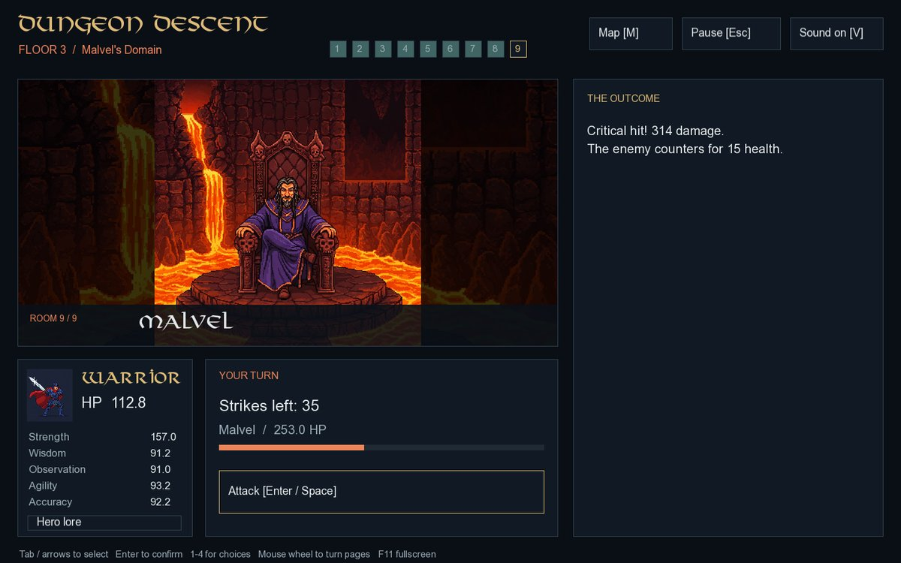

# Floor 3 — Malvel's Domain

Defeating the second guardian opens **Enter Malvel's domain**. This leads directly into the Lava biome with the same hero, health, stats, reputation and counters. There is no extra biome choice, healing or repeated class ability. The descent continues until game over or an ending; floor clears and pause menus cannot start another run.

## Route and story

| Rooms | Content |
| --- | --- |
| 1–3 | Library, sealed chest and mini dragon battle, shuffled once on entry. |
| 4 | A second sealed chest. |
| 5 | Lava knight. Confront or sneak past. |
| 6 | Lava merchant with three original items. |
| 7 | Malvel's minions. Threaten them for their account and reputation, or kill them for stats. |
| 8 | Respite. Rest in the sauna for Health or search for supplies. |
| 9 | Malvel. The final battle determines the ending. |

The library's **The Princess Diary** gives Strength and reputation, alongside the original diary revelation. Its other books increase Agility, Wisdom or Observation. Solving and claiming the opening chest reveals the original glowing orb story and gives reputation. The fourth-room chest gives treasure without additional reputation. Both chests require their own correct riddle answer; loot and reputation can only be claimed once.

Room illustrations, descriptions, diary/orb/minion stories, the third-floor map, lava music and the first three endings come from the original game. The fourth ending has a new story and the supplied princess-confrontation image. The existing 35 hard riddles are unchanged. Each floor selects eight questions without replacement and shuffles answer positions.

## Rules and rewards

| Rule | Floor 3 |
| --- | --- |
| Riddle timer | `10 + floor(Wisdom / 2)` seconds. |
| Correct answer | All stats `+2.25`, before class multipliers. |
| Incorrect answer / timeout | All stats `-4.5` / `-1.5`, clamped at zero. |
| Observation above 30 | Hides one false answer, including its input target. |
| Mini dragon / lava knight / Malvel health | `126 / 126 / 567`. |
| Enemy retaliation | `9 / 12 / 15` Health respectively; killing blows prevent retaliation. |
| Ordinary victory / retreat | All stats `+3` / `-2.25`. |
| Each chest | All stats `+6`; the opening chest also gives reputation and the orb story. |
| Library books | One stat `+2`; the diary also gives reputation and its story. |
| Respite | Health `+10`, or all stats `+6`. |
| Threaten / kill minions | Reputation `+1` and story / all stats `+6`. |
| Emberheart Elixir | Health `+5`. |
| Corebound Tincture | Strength `+2`. |
| Inferno Draught | All stats `+6`. |

Class multipliers apply to rewards. Fixed individual-stat rewards do not scale with floor number. Combat keeps class-primary damage, Accuracy critical hits and Agility strike counts. Malvel's defeat is counted in the final battle total; there is no post-final-battle stat reward.

## Endings

| Ending | Condition |
| --- | --- |
| **A Crown in Ashes** — perfect | Defeat Malvel after fighting and winning **all 9 battles**, answering **all 24 riddles correctly**, and earning **9 reputation**. |
| **Justice for Falkreath** — true | When the perfect-run requirements are not met, defeat Malvel with reputation **at least 5**, and either **at least 14 correct riddles** or **at least 5 battles won**. |
| **Hero of Aethoria?** — good | Defeat Malvel without meeting the true-ending requirements. |
| **Dungeon Demise** — bad | Lose to Malvel through zero Health or exhausted strikes. |

The perfect ending is checked before the true ending and requires exact complete-run totals, including Malvel's victory. A skipped battle, ordinary retreat, wrong/expired riddle or missed reputation event prevents it. The three battles on each floor are its two ordinary combat rooms and its guardian. Existing encounter reputation choices are unchanged.

In **A Crown in Ashes**, the hero confronts Sophie with the complete evidence, kills her before she can command the weapon, destroys its focusing seal, and returns to expose the king's treatment of Falkreath. The supplied image is stored unchanged as `assets/images/ending/perfectending.jpg`, paired with the new story in `assets/textfiles/ending/perfectending.txt`.

All four complete ending stories are paginated, followed by results for the whole journey: the original integer stat-total score, floor reached, answered/correct riddles, battles, reputation, remaining Health and playtime. Playtime includes pauses and floor transitions, freezes at an ending or game over, and resets only when a new run starts. Earlier death or guardian defeat gives game over. A new descent can be started from the main menu after results; room/floor retry checkpoints have been removed.

## Verification

Rules checks cover 800 first-floor regression runs and 1,600 full three-floor runs across every hero and first/second-floor biome pairing. Additional complete runs earn the perfect ending with every hero/biome combination. Checks cover all four endings, exact thresholds and near misses, hard-riddle penalties, both lava chests, diary/minion stories, all shop choices, scaled rewards, asset paths and terminal states.

Optional SFML tests drive Ice–Desert–Lava and Jungle–Ghost–Lava, all four endings/results, lore-tab selection, maps, page controls, fullscreen/F11 and continuous-run navigation. A legitimately earned perfect run is finished with actual attack-button input; its supplied image, complete story pagination and 100% results are checked. Timed riddles remain unpausable through focus loss and quit confirmation. Linux builds and software-rendered tests are used for validation; Windows compilation and audible playback must still be checked on Windows.
