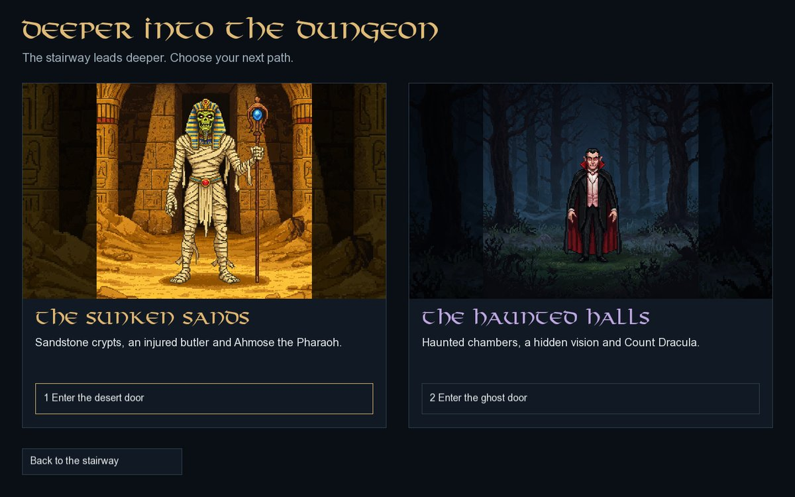

# Floor 2 — Desert and Ghost

The second floor is entered from **Descend the stairway** after defeating the Yeti or Jungle Warden. Choose the Desert or Ghost door; the same hero continues with their current health, every stat, reputation, riddle results and battle counters. No class ability is reapplied and no free healing is added at the transition. Both first-floor biomes can lead to either second-floor biome.

## Route and story

| Rooms | Content |
| --- | --- |
| 1–3 | Library, sealed chest and ordinary battle, shuffled once on entry. |
| 4 | Desert/Ghost merchant, with biome-specific items. |
| 5 | Second sealed chest. A correct seal answer unlocks the orb vision about Sophie and Malvel. Claiming this chest gives reputation once. |
| 6 | Wounded butler. Save him for reputation and his original story, or take the vial for stats and leave him to die. |
| 7 | Respite. Drink for Health or search for supplies. |
| 8 | Giant scorpion (Desert) or Werewolf (Ghost). Confront or sneak past. |
| 9 | Ahmose the Pharaoh (Desert) or Count Dracula (Ghost). Victory is required to clear the floor. |

The original floor-two map, room illustrations, shop/library names, medium-riddle bank, music, chest vision, butler dialogue and guardian revelations are used. Desert encounters preserve the original Sandwyrm opening battle and scorpion in room 8. Their image and story files use different numbering, which is handled explicitly. Recycled desert scenery in the Ghost guardian's victory text is corrected to castle/mist imagery; the revelation dialogue and plot are retained.

Eight medium riddles follow the eight non-boss rooms. Both chests must be unlocked separately. A failed or expired seal denies that chest's loot, and the fifth-room vision and reputation are unavailable if its seal is failed. The guardian has no riddle. The second guardian awards reputation and delivers its original revelation. Results display cumulative progress across both floors, up to 16 riddles, six fought battles and six reputation events.

## Difficulty and rewards

| Rule | Floor 2 |
| --- | --- |
| Question bank | 37 original medium riddles; eight selected without replacement. |
| Time per riddle | `15 + floor(Wisdom / 2)` seconds. |
| Correct answer | All stats `+1.5`, before class multipliers. |
| Incorrect answer / timeout | All stats `-3` / `-1`, clamped to zero. |
| Observation above 30 | Eliminates one randomly selected false answer. The correct answer remains available. |
| Ordinary enemy / guardian health | 68 / 306. |
| Enemy retaliation | 6 Health in an opening battle, 8 in room 8, 10 in the guardian battle. Killing blows prevent retaliation. |
| Victory / ordinary retreat | All stats `+2` / `-1.5`; class bonuses apply to gains. |
| Each chest | All stats `+4`, before class multipliers; room 5 also gives the vision and reputation. |
| Library | One of Strength, Agility, Wisdom or Observation `+2`, with the hero's individual-stat multiplier. |
| Respite | Health `+10`, or all stats `+4`, with class multipliers. Drinking here gives no reputation. |
| Take the butler's vial | All stats `+3`, with class multipliers; no reputation. |

The first-floor primary-stat damage, Accuracy-based critical hits and Agility-based strike count remain. The original per-floor scaling is applied to all-stat gains and penalties; individual stat items retain their original fixed amounts.

| Merchant choice | Desert | Ghost |
| --- | --- | --- |
| Health item | Draught of Revitalization: Health `+5`. | Elixir of Restless Slumber: Health `+5`. |
| Power item | Essence of Fortitude: Strength `+1.5`. | Phantom's Breath: all stats `+4`. |
| Knowledge item | Scroll of Ancient Wisdom: Wisdom `+2`. | Scroll of Lost Echoes: Wisdom `+2`. |

Each room allows one choice. Class multipliers also apply to these gains. A failed guardian fight does not open a third-floor door.

## Continuous descent and controls

The second guardian opens **Enter Malvel's domain**, which continues the same descent into [floor 3](FLOOR_THREE.md). Floor transitions and pause menus offer no new-descent or main-menu action. Room/floor retries have been removed; game over or an ending leads to results, then the main menu.

The current floor number, biome colour, room titles, artwork, music and map update at descent. Escape from the second-floor door choice returns to the first-floor result without losing progress. Timed riddles cannot be paused on either floor. Pause, map and hero-lore controls are disabled while a countdown is active. Focus loss and quit confirmation do not stop the clock. Actual elapsed time is charged before accepting new input, so returning to a delayed window cannot accept an expired answer. Long story revelations have page controls and mouse-wheel/arrow navigation.

The game now starts in fullscreen. **F11** switches between fullscreen and a resizable window. All controls and letterboxing use the same logical canvas.

The SFML-independent `DungeonRun` model is shared by all three floors. CMake and the Visual Studio project compile the same model and retain the native Windows launch settings. Disk save/load is not implemented.

Validation covers 800 first-floor regression runs and 1,600 complete three-floor runs across all hero and biome combinations. Focused checks cover carryover, scaling, vision/reputation gating, hidden-answer input, terminal states and forbidden descents. Actual SFML render/input tests traverse both second-floor guardians and continue to Lava, including story pagination, maps, unpausable timers through focus loss and quit confirmation, and fullscreen/F11. Windows compilation and audible playback remain to be checked on Windows.
